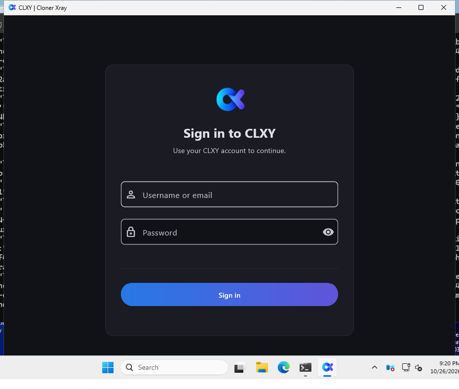

<h1 align="center">CLXY | Cloner Xray</h1>
<p align="center">Windows desktop downloads, release notes, and installation guide.</p>
<p align="center">
  <a href="https://github.com/ClxybyCloner/clxy-windows-downloads/releases/download/v1.0.5/CLXY-1.0.5-Windows-Setup-x64.exe"><strong>Download CLXY 1.0.5 for Windows x64</strong></a>
  &nbsp; · &nbsp;
  <a href="https://github.com/ClxybyCloner/clxy-windows-downloads/releases/tag/v1.0.5">Release details</a>
  &nbsp; · &nbsp;
  <a href="#verify-your-download">Verify your download</a>
</p>

> **Before you install:** this installer is unsigned. Windows may show an unknown-publisher or SmartScreen warning. Installation and local app/core startup were tested, but real account sign-in and live VPN/proxy traffic were not.

<p align="center">
  
</p>
<p align="center"><sub>The installed Windows app during a launch check. This screenshot does not demonstrate successful account authentication or a working VPN connection.</sub></p>

## Download

| Item | Details |
| --- | --- |
| Release | **1.0.5** |
| App version | `1.0.5+119` |
| Platform | Windows x64 |
| Installer | [`CLXY-1.0.5-Windows-Setup-x64.exe`](https://github.com/ClxybyCloner/clxy-windows-downloads/releases/download/v1.0.5/CLXY-1.0.5-Windows-Setup-x64.exe) |
| Installer size | 18,395,982 bytes |
| Portable ZIP | [`CLXY-1.0.5-Windows-x64.zip`](https://github.com/ClxybyCloner/clxy-windows-downloads/releases/download/v1.0.5/CLXY-1.0.5-Windows-x64.zip) |
| Portable ZIP size | 22,402,537 bytes |
| Code signing | Unsigned; no Authenticode certificate |
| Checksums | [`SHA256SUMS.txt`](https://github.com/ClxybyCloner/clxy-windows-downloads/releases/download/v1.0.5/SHA256SUMS.txt); [checksum history](CHECKSUMS.txt) |

This repository is a **binary-download and documentation channel**. It does not mirror the application source code. The installer and portable ZIP are attached to the [GitHub Release](https://github.com/ClxybyCloner/clxy-windows-downloads/releases/tag/v1.0.5), rather than stored in the repository's file history.

GitHub's **Code > Download ZIP** and automatically generated **Source code** archives contain this repository's documentation. They are not the Windows installer. Choose the installer `.exe` or portable Windows `.zip` release asset above, not a source-code archive.

## What CLXY is

CLXY is an independent, unofficial Windows desktop client with a Flutter interface and a bundled Go core. The app starts its local core and communicates with it over loopback. The package includes the sign-in/onboarding interface, desktop integration, and required legal notices.

CLXY is an independent third-party client; account and upstream-service access are external dependencies. Publishing this installer does not provide an account or guarantee service access.

The upstream proxy is TCP-only and accepts web ports **80, 443, 8080, and 8443**. UDP-dependent applications and other ports may not work. Do not assume that every application's traffic is protected merely because the desktop app is open.

## Install on Windows

The intended target is **Windows 10 or Windows 11 on an x64 PC**. This release does not include an ARM64 or 32-bit Windows package. The release check was a Windows-runner smoke test, not a broad OS or hardware compatibility certification.

1. Download the [Windows x64 EXE](https://github.com/ClxybyCloner/clxy-windows-downloads/releases/download/v1.0.5/CLXY-1.0.5-Windows-Setup-x64.exe).
2. [Check its SHA-256](#verify-your-download) before running it.
3. Open the installer and follow its prompts. The installer is intended for the current Windows user.
4. Launch **CLXY | Cloner Xray** from the installer or Start menu.
5. Read the account and network limitations above before trying to sign in or connect.

The normal installation folder is `%LOCALAPPDATA%\Programs\CLXY`. The app keeps its account data, settings, and logs in a `user-data` folder beside the installed app. Treat that folder as private.

### Portable copy

Download the [portable Windows ZIP](https://github.com/ClxybyCloner/clxy-windows-downloads/releases/download/v1.0.5/CLXY-1.0.5-Windows-x64.zip), verify its SHA-256, extract the `CLXY` folder, and run `clxy.exe`. Keep the folder writable; the app stores its private `user-data` beside the executable.

### Windows security warnings

The installer does not carry a publisher signature. A successful installation test does not establish SmartScreen reputation or verify publisher identity.

Only proceed if you trust this repository and the downloaded file matches the checksum. Do not disable Defender, antivirus protection, or an organization's security policy to install it. If you are unsure about a warning, stop. A matching hash proves that the file matches this publication; it is not a security audit.

## Verify your download

Open PowerShell in the folder containing your download. Run the command for the file you downloaded:

```powershell
Get-FileHash -Algorithm SHA256 -LiteralPath .\CLXY-1.0.5-Windows-Setup-x64.exe
Get-FileHash -Algorithm SHA256 -LiteralPath .\CLXY-1.0.5-Windows-x64.zip
```

Each `Hash` must match the corresponding entry below (letter case does not matter):

```text
66b34089208d1174abcebd0d75114884b751f99f0fe9a40f91fd11befbacee9b  CLXY-1.0.5-Windows-Setup-x64.exe
7c038177002da703458ffc9a921e40310d39ee4a4b3bb1ac2f7413870f9df51d  CLXY-1.0.5-Windows-x64.zip
```

If it differs, do not run the file. Download it again from this repository's release page. Microsoft documents the command in [Get-FileHash](https://learn.microsoft.com/en-us/powershell/module/microsoft.powershell.utility/get-filehash).

## What was actually checked

The release candidate passed these checks before publication:

| Check | Result |
| --- | --- |
| Flutter static analysis | Passed |
| Automated Flutter tests | 132 passed |
| Web Logs sanitizer tests | 2 passed |
| Go static analysis and tests | Passed |
| Windows x64 installer build and AMD64 checks | Passed |
| Bundled legal assets, including Inter and Vazirmatn notices | Passed, byte-for-byte |
| Real installation on a Windows runner | Passed |
| Installed app window, real core, and local HTTP endpoint | Passed |
| Installed Go notice files compared with their release source | 37 files matched byte-for-byte |
| Real uninstallation and app/core/shortcut removal | Passed |

The sign-in/onboarding UI tests used fake APIs and synthetic data. They do not demonstrate that a real account can authenticate.

**Not validated:** real provider sign-in, token validity, live VPN/proxy traffic, tunnel establishment, external routing, or external DNS behavior. No independent security audit, privacy guarantee, speed claim, or availability guarantee is made here.

## Updating, backups, and removal

Keep a private backup of any account data or settings you need before changing an installation. Close CLXY before replacing installed application files, and use the same installation location when updating.

Starting with 1.0.5, CLXY checks this repository's latest stable release when a check is due, about one minute after startup. It checks whether another look is due each hour; successful checks are cached for five days. Use **About** for an immediate check. A dismissible in-app notice offers **Download** for a newer version. Installed copies download the installer; portable copies download the Windows ZIP. CLXY does not install updates automatically.

To remove the app, use **Windows Settings > Apps** and choose CLXY's uninstall entry. User data may remain after uninstalling, so do not assume removal erases saved account information. Delete retained data only when you no longer need it.

## Troubleshooting and feedback

If the app does not start, confirm that you downloaded the Windows x64 package and that its SHA-256 matches. Avoid running multiple copies from different folders while diagnosing an installation problem.

If sign-in or connection fails, remember that these paths were not validated against a real account or live upstream service for this release. A running app or responsive local core does not prove that the upstream connection works.

For reproducible installation or UI problems, [open an issue](https://github.com/ClxybyCloner/clxy-windows-downloads/issues) with the app version, Windows version, steps to reproduce, and expected versus actual behavior. Redact screenshots and logs first. Never post passwords, access tokens, cookies, recovery codes, or account-data folders in a public issue.

## License and acknowledgments

The original project's MIT copyright and permission notice is preserved verbatim in [`LICENSE`](LICENSE). CLXY's branding does not remove those obligations or the licenses of bundled dependencies.

See [`THIRD-PARTY-NOTICES.md`](THIRD-PARTY-NOTICES.md) and [`THIRD-PARTY-LICENSES.txt`](THIRD-PARTY-LICENSES.txt) for the redistributed legal texts. The installed application also contains its bundled legal notices, including Flutter/Dart dependency notices, fonts, flags, artwork, and Go components. Keep those notices with any redistributed copy.

See [`CHANGELOG.md`](CHANGELOG.md) for this public download channel's release history.
